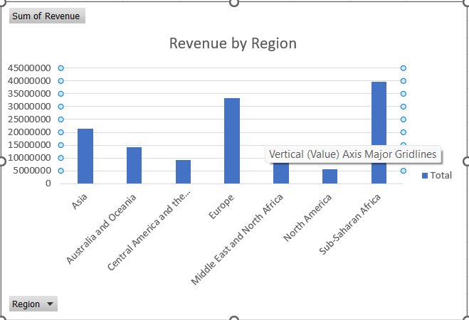

# Sales Data Analysis

Analysis of a sales dataset to find top-selling products and revenue by region.

## Tools
Python (Pandas), Excel

## What I did
1. Cleaned the data in Pandas: removed duplicates, handled missing values, and fixed date formats.
2. Calculated revenue (units sold x unit price).
3. Grouped revenue by product, month, and region.
4. Built an Excel PivotTable and chart for revenue by region.

## Key findings
- Cosmetics earned the most revenue (about 36.6M), followed by Office Supplies and Household.
- Sub-Saharan Africa had the highest regional revenue (about 39.7M), followed by Europe.
- North America had the lowest regional revenue (about 5.6M).

## Chart

## Files
- `analysis.py`: data cleaning and analysis
- `sales_clean.csv`: cleaned data
- `sales_analysis.xlsx`: PivotTable and chart

## Dataset
Kaggle: anairamcosta/sales-csv

## How to run
1. Install pandas: `python -m pip install pandas`
2. Put `sales.csv` in the same folder as `analysis.py`
3. Run `python analysis.py`
